# Flowcharts

These diagrams use **Mermaid**. GitHub renders them automatically in Markdown files.

## F1. Login and role-based access control

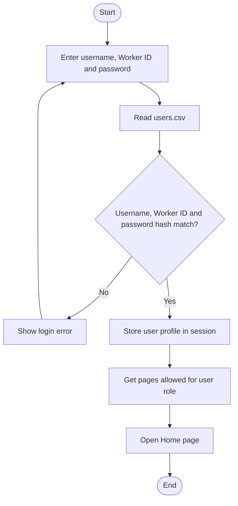

## F2. Administrator account creation

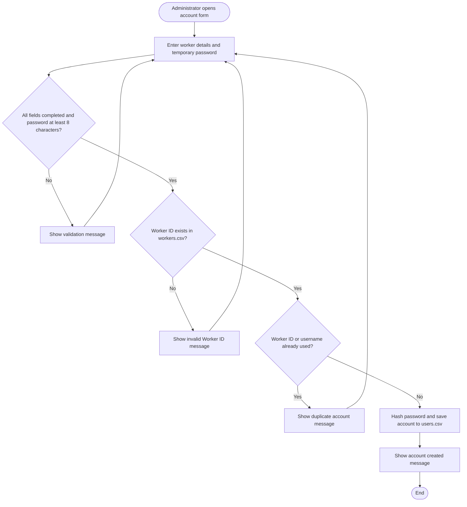

## F3. Data upload and validation

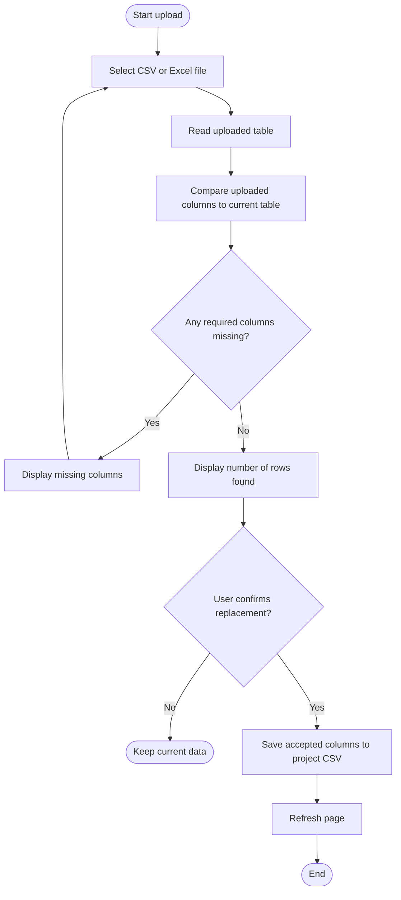

## F4. Change password

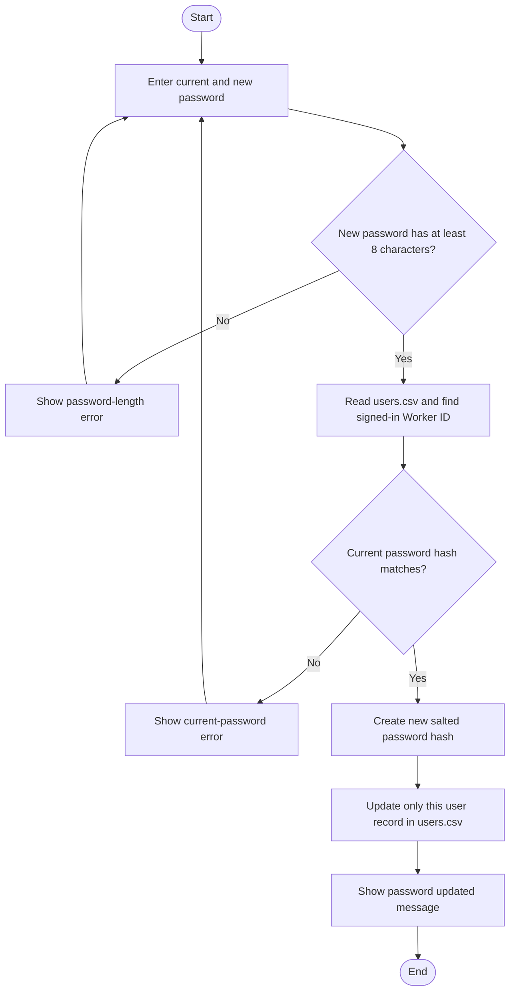

## F5. Global search

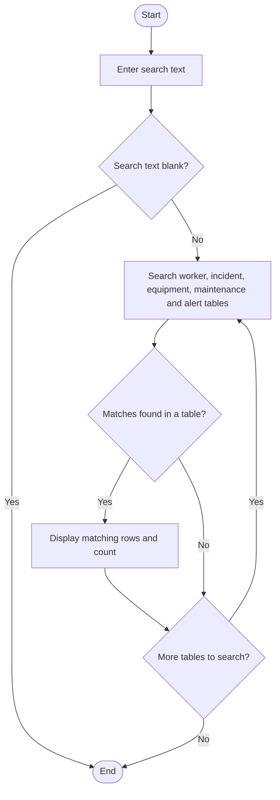

## F6. Worker safety observation

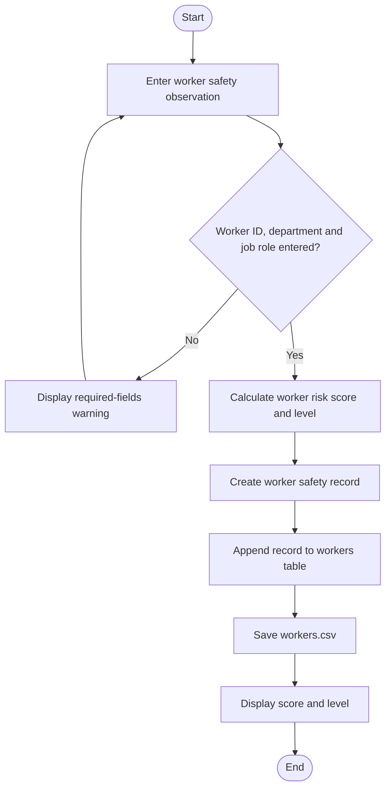

## F7. Incident record and filter

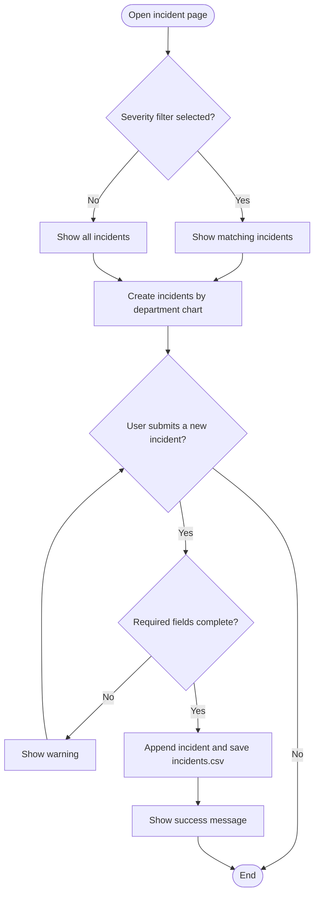

## F8. Equipment condition monitoring

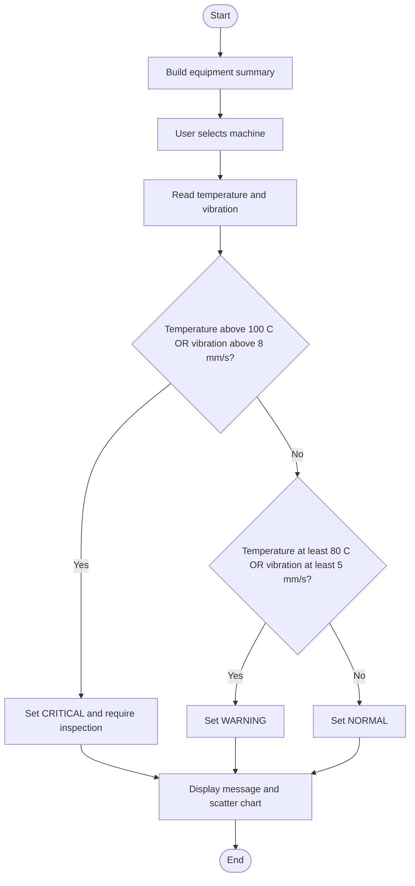

## F9. Maintenance monitoring

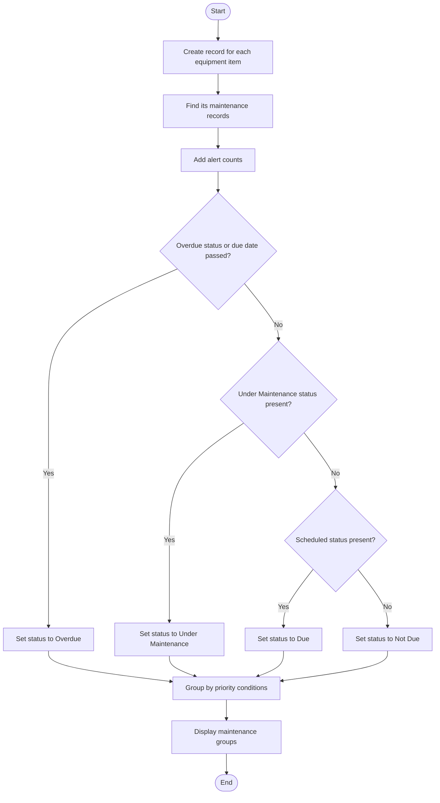

## F10. Risk assessment

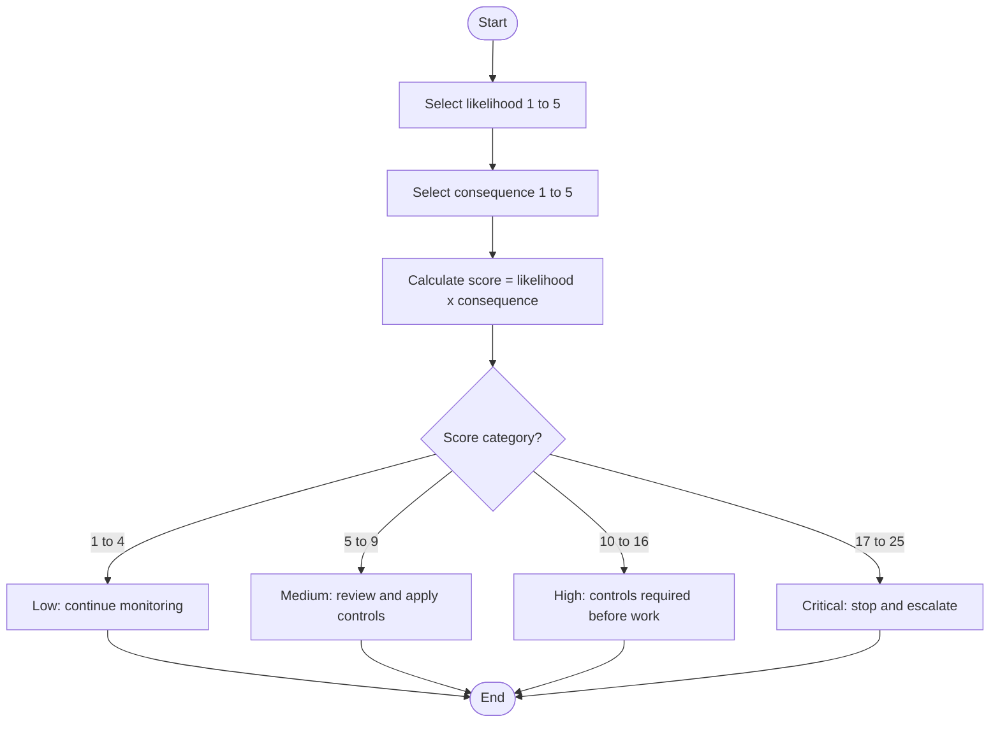

## F11. Alert generation and dashboard

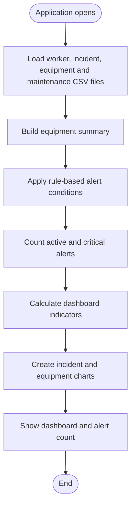

## F12. Navigation and sign out

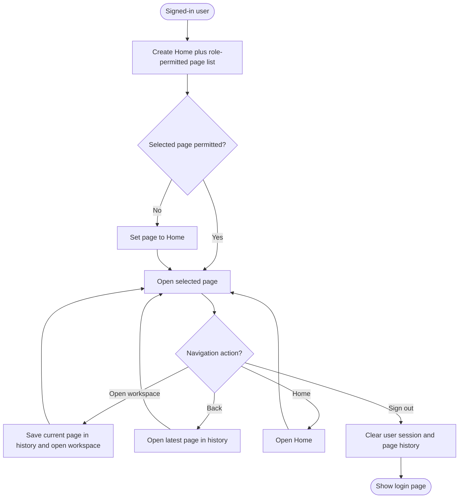
